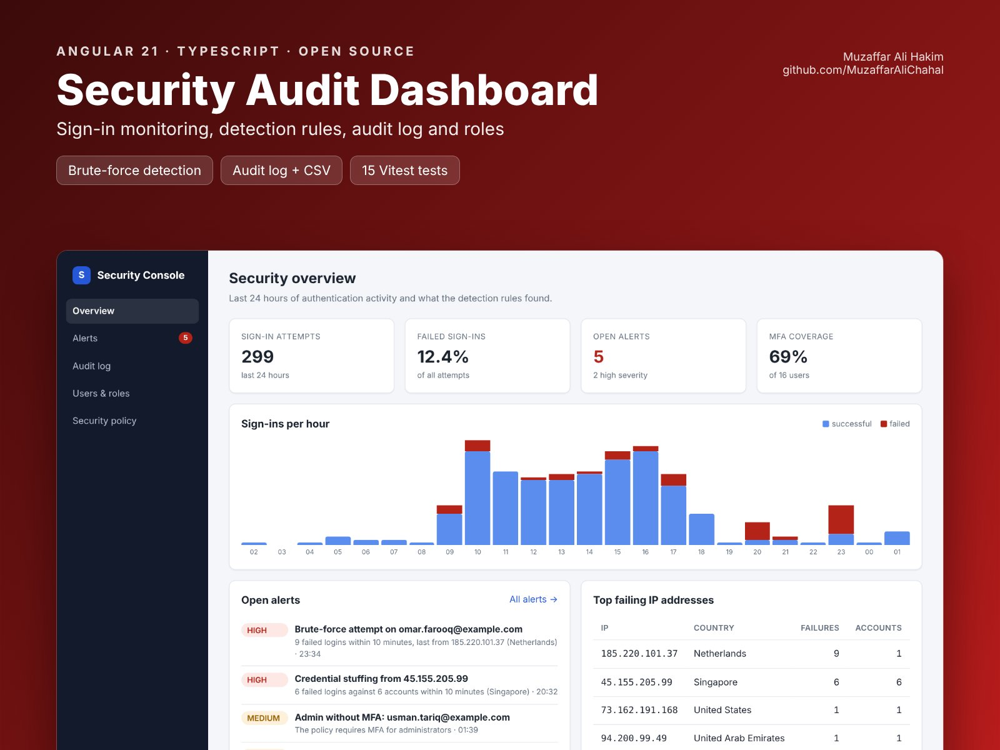

# Security Audit Dashboard (Angular)


   

An Angular 21 security console for a web application: sign-in monitoring, detection rules that raise alerts, an audit log, user roles and a security policy editor.

**Live demo:** https://muzaffaralichahal.github.io/angular-security-dashboard/ (24 hours of generated audit data with three attacks planted in it)



## Features

- **Overview:** sign-in attempts, failed sign-in rate, open alerts, MFA coverage, sign-ins per hour (successful vs failed) and the top failing IP addresses
- **Detection rules** (pure functions in [`detection.ts`](src/app/core/detection.ts)):
  - Brute force: 5+ failed sign-ins for one account within 10 minutes (sliding window)
  - Credential stuffing: one IP failing against 3+ accounts within 10 minutes
  - Impossible travel: successful sign-ins from two countries less than an hour apart
  - Admin without MFA, while the policy requires it
  - Privilege escalation: any role change that grants ADMIN
- **Alerts:** sorted by severity, acknowledge when investigated
- **Audit log:** filter by event type or search by user, IP or country; pagination; CSV export
- **Users & roles:** change roles, lock and unlock accounts. Every change is written to the audit log with who made it, and you can't lock yourself out.
- **Security policy:** password length, lockout threshold and duration, session timeout, MFA for admins. Saving records exactly what changed.

## How it's built

| Concern | Approach |
| --- | --- |
| State | One signal store (`SecurityStore`); alerts, statistics and the hourly chart are all `computed()`, so a role change or policy change updates every screen at once |
| Rules | Detection is plain TypeScript with no Angular dependency, easy to unit test or move to the server |
| API layer | Abstract `SecurityApi` with an HTTP implementation for the contract in [`docs/api.md`](docs/api.md) and an in-memory demo implementation |
| Demo data | Seeded random generator, so the demo looks the same on every load |
| Charts | Plain HTML/CSS, no chart library |
| Tests | 15 Vitest tests covering every detection rule and the store (role change → audit event → alert) |

## Run it

```bash
npm install
npm start      # demo mode at http://localhost:4200
npm test
```

To use a real backend, implement [`docs/api.md`](docs/api.md) (for example with Spring Boot and Spring Security) and run `npx ng serve --configuration live`, which proxies `/api` to `http://localhost:8080`.

## Deployment

GitHub Actions runs the tests, builds with the right `--base-href`, and publishes the demo to GitHub Pages on every push to `main`.

## License

MIT
